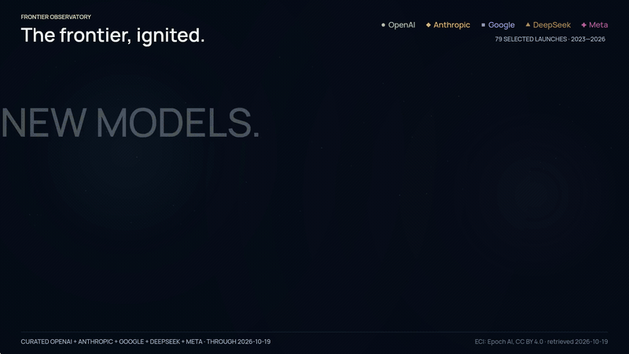

# Frontier Model Release Timeline

[](https://github.com/crosscore/frontier-model-release-timeline/actions/workflows/ci.yml)

Frontier AIモデルの発表が重なっていく様子を、編集可能なJSONから動画にするローカル生成ツールです。GoogleはGemini以前の主系統PaLM 2も含みます。業界全体を網羅したデータではありません。花火は横軸＝発表日、縦軸＝[Epoch AIのEpoch Capabilities Index（ECI）](https://epoch.ai/benchmarks/eci)のグラフ上で、各モデルのスコアの高さで開きます。

<!-- dataset-summary:start -->
**116モデル（2023-01-01〜2026-10-19）**を公式出典付きで収録しています。OpenAI 34 / Anthropic 29 / Google 21 / DeepSeek 17 / Meta 15。ECIあり100モデル、未採点16モデルです。
<!-- dataset-summary:end -->

[横長MP4](https://github.com/crosscore/frontier-model-release-timeline/raw/refs/heads/main/preview/frontier-landscape.mp4) · [縦長MP4](https://github.com/crosscore/frontier-model-release-timeline/raw/refs/heads/main/preview/frontier-portrait.mp4) · [全出典CSV](preview/sources.csv) · [集計方法](docs/methodology.md)



GIFは無音・6fps・幅640px（全60秒）の見本です。BGMと滑らかな動きは上のMP4から確認できます。

60秒、32小節・30fps（1800フレーム）、オリジナルBGM・打上げ音付き。横長1920×1080と縦長1080×1920のMP4、GIF、ポスター、英語字幕、出典一覧ページを同梱しています。映像は英語、操作手順は日本語です。

## 再生成

Node.js 22以上と、H.264エンコーダーを含むFFmpegが必要です。Macでは `brew install node ffmpeg` で導入できます。APIキー・有料API・ブラウザ自動化は不要です。初回の依存取得後はオフラインで描画できます。

```bash
git clone https://github.com/crosscore/frontier-model-release-timeline.git
cd frontier-model-release-timeline
npm ci --ignore-scripts
npm test
npm run build
npm run render
npm run render -- --format portrait
npm run verify:media
npm run verify:media -- --format portrait
npm run verify:artifacts
npm run qa:visual
npm run preview
```

`http://127.0.0.1:4173` で動画と出典一覧を開きます。`build` は静止画・一覧を準備し、`render` が動画を生成します。生成先はGit管理外の `dist/` です。音も毎回ローカルで合成・マスタリングします。保存済み動画をすぐ見る場合は `npm run preview -- --out preview` を使用してください。プレビューは自動再生しません。

```bash
# 軽量版（3秒に圧縮した動作確認用。共有用には通常の長さを推奨）
npm run render -- --width 640 --fps 10 --duration 3 --no-gif

# 別のデータ・出力先、縦長720p
npm run render -- --data data/releases.json --out output --format portrait --width 720

# 指定10区間を等速で確認する短い動画・原寸PNG（両形式）
node scripts/smoke-per-model.mjs

# 同梱プレビューを更新する場合
npm run build -- --out preview
npm run render -- --out preview
npm run render -- --out preview --format portrait
```

選定単位は「名前の違う汎用モデル1つ＝花火1発」です。主系統の小型・高速な階層（Haiku、mini、nano、Instant、Flash、Flash-Lite、Lite、Glimmerなど）も、名前つきで公開発表されたものを含めます。パラメータ数だけ違うサイズはまとめ、最大の公開サイズのECIを使います。公開プレビューは含め、予告だけの場合は実際の初公開日を使います。

除外は、同じ名前の更新・日付つきスナップショット・提供経路や入力機能・文脈長の追加（新しい選択名ではない）、計算量だけのモード（Pro、Deep Think、Specialeなど）、特化系・メディア・安全用、他社モデルの蒸留・研究用試作・端末内専用、主系統を補助する別系列のオープンウェイト（gpt-oss、Gemma）と既存Muse Sparkの重み公開、限定公開・未公開です。ChatGPTの内部振り分け先や上限後の代替も、発表時に名前で選べるモデルでなければ含めません。PaLM 2はGemini以前のGoogleの主系統として含めます。具体例と境界は[方法論](docs/methodology.md#unit-and-inclusion)に記載しています。

## データを更新

1. [data/releases.json](data/releases.json) の `releases` に日付順で追加します。`sources` には公式発表または公式リリースノートのHTTPS URLを入れます。
2. 1レコード＝1モデル（schemaVersion 3）です。同じ会社・同じ日でも名前が違えば別レコードにします。同じ会社・日付・名前の重複は検証で拒否します。プレビューは `stage: "preview"` で明示します。
3. [選定ルール](docs/methodology.md) に照らして対象を確認し、必要に応じて `endDate` と `verifiedOn` を更新します。
4. 能力スコアを付ける場合は `capability.model` にEpoch AIのECI一覧でのモデル名を入れ、`npm run scores` でEpochの公開CSVからスコアを取り込みます（ネット接続が必要。未採点のモデルは `score: null` のまま地上の噴き出し花火になります）。対応づけの規則は[集計方法](docs/methodology.md#capability-scores)を参照してください。
5. `npm run validate && npm test` を実行してから再生成します。日付の正しさ・採否の判断は人が一次情報で確認してください。CIは出典本文の自動事実確認を行いません。

最小イベント例（既存行を編集する形で利用）:

```json
{
  "id": "openai-gpt-4",
  "date": "2023-03-14",
  "lab": "openai",
  "name": "GPT-4",
  "stage": "release",
  "capability": { "model": "GPT-4 (Mar 2023)", "score": 125.88 },
  "sources": [{
    "url": "https://openai.com/index/gpt-4-research/",
    "title": "GPT-4 — official announcement"
  }]
}
```

## 映像の読み方

- 1つの開花＝1モデルです。同じ会社・同じ日のモデルを「発表」と呼び、ECI順（未採点は末尾、同点と未採点同士はJSON順）に連発します。発表の先頭は日付ちょうど、2つめ以降は16分音符（0.1171875秒）ずつ遅れて開き、各発の0.36秒前に上昇が始まります。位置は日付と各モデルのECIのままです。別会社の同日の先頭は同時に開きます。
- 横軸は2023年1月〜2026年12月の通しの暦（観測終了日より後は斜線）、縦軸はECIスコアです。花火は発表日の位置から真上に上がり、そのモデルのECIの高さで開きます。開いた点はマーカーとして残り、会社ごとの「その時点の最高スコア」を階段状の線で結ぶので、能力が上がっていく様子がグラフとして積み上がります。
<!-- unscored:start -->
未採点は16モデル: Claude（2023-03-14）、Claude Instant（2023-03-14）、PaLM 2（2023-05-10）、Gemini Ultra 1.0（2024-02-08）、Gemini 1.5 Pro（2024-02-15）、DeepSeek V2-Lite（2024-05-16）、DeepSeek V2.5（2024-09-05）、DeepSeek R1-Lite-Preview（2024-11-20）、Gemini 2.0 Flash-Lite（2025-02-05）、GPT-5.1 Instant（2025-11-12）、GPT-5.2 Instant（2025-12-11）、GPT-5.3 Instant（2026-03-03）、Muse Glimmer（2026-08-10）、Muse Wonder（2026-10-12）、Muse Wonder Full（2026-10-12）、DeepSeek V4.1 Flash-1017（2026-10-17）。高さを持たない横軸上の噴き出し花火で表し、一覧は「—」です。
<!-- unscored:end -->

- カメラは暦の「今」と最近のスコアを滑らかに追い、構成に合わせてゆっくり寄ります。拍・小節・発表ごとの拡大、周期的な引き、揺れをすべて外しました。開いた花火の横にはモデル名とECI（未採点は NOT YET SCORED）の名札が最大約1.6秒出ます。名札は1行＝1発表で、全モデル名を共通の先頭語だけ省いて連ね（Claude Opus 4 · Sonnet 4）、同じ順で全ECIを表示します。名札は花火と階段線の手前に重ね、暗い背景板と会社色の細い枠で読みやすくしています。0.3秒以内の近接発表は最大3行にまとめ、次の名札と重なる前に切り替えます。終了日の4小節前からさらにゆっくり寄り、観測終了日のドロップでグラフ全体へ引きます。カメラは時刻だけで決まるので、どのフレームも単独で同じ絵になります。
- 横長ではグラフの右（縦長では下）に**発表ペース**を並べています。株価チャートと並べるRSIのような指標で、ECIのグラフと同じ暦・同じカメラで動きます。値はモデル数の指数移動平均（時定数60日）を「MODELS / YEAR」に年換算したもので、各モデルの開花時刻に約6.1ずつ跳ね上がり（花火と同時に会社の色の輪が開き、下端に会社別の形のマーカーが5段で残ります）、次の発表まで減衰します。g日に1件の一定ペースなら平均365/gに落ち着くので、点線の目盛りは60日・30日・14日・7日に1モデル（高密度では3日に1モデルも追加）（年6・12・26・52・約122モデル）の位置です。縦軸はペースが過去最高を更新するたびに広がるので、目盛りが下へ沈んでいくこと自体が加速を表します。観測開始（2023-01-01）より前の発表はデータに含めていないため、曲線は0から始まり、2023年初めの値は実際より低く出ます。
- MintがOpenAI、AmberがAnthropic、青紫がGoogle、銅色がDeepSeek、ローズがMeta。既存3色を保ち、5社それぞれに異なる開花とマーカーの形を割り当て、色に頼らず見分けられます。半径・粒子数・寿命は全発表で同じです。プレビューはモデル名の `*` と中空のマーカーで区別します。
- ECIは多数のベンチマークを1つの尺度にまとめた指数で、各スコアには数ポイント幅の不確かさがあります。数点の差は順位の根拠になりません。各モデルはそれぞれ対応するECIを使います。
- モデル名の一覧は横長で5列、縦長で3社＋2社の2段です。1行＝1発表で、各社とも常に最新の発表が一番上です。全モデル名を連ね、必要なら名前を2行に折り返し、右端には先頭モデルのECI（整数に丸め）を表示します。新着は上から入り、その行の実際の高さだけ古い行を押し下げます。名前が1行に収まれば元の文字サイズを保ち、長い結合名だけ「 · 」の後で2行にします。日付は最後の名前行のすぐ下に置きます。列の下端で古い行がフェードし、2行の名前があると見える発表が3つになる場合があります。各発表の名前・日付・スコアは列内で最低1.4秒、欠けずに表示され、最新の名前は最後の静止区間まで表示されます。狭い一覧ではClaude・DeepSeekの反復する会社名を省略します（Claude 2等の数字だけの名前は維持）。日付は名前と別行に表示します。行内のモデルを +N や省略記号で隠さず、全正式名は字幕と出典一覧にも残ります。
- 最後の棒グラフは **観測日数 ÷ 選定モデル数**。平均発表間隔や開発期間とは異なります。2026年は292日分の途中集計です。右側（縦長では下）には、初年と最終年それぞれで選定モデル中の最高ECI（126 → 167）を表示します。

| 会社 | 色 | マーカー | 開花 |
| --- | --- | --- | --- |
| OpenAI | Mint `#76D3B2` | 丸 | 牡丹 |
| Anthropic | Amber `#FFB547` | ひし形 | 長い尾のきらめき |
| Google | 青紫 `#9AA5FF` | 四角 | 二重の輪 |
| DeepSeek | 銅色 `#D2823C` | 三角 | 上方へ広がる扇 |
| Meta | ローズ `#DC50A0` | 十字 | 四方向の星 |

<!-- yearly-stats:start -->
| Observation | Days | Models | Days / model |
| --- | ---: | ---: | ---: |
| 2023 | 365 | 12 | 30.4 |
| 2024 | 366 | 24 | 15.3 |
| 2025 | 365 | 36 | 10.1 |
| 2026-01-01–2026-10-19 | 292 | 44 | 6.6 |
<!-- yearly-stats:end -->

<!-- pace-summary:start -->
観測終了日のペースは年83.8モデル（約4.4日に1モデル）です。2026年途中集計の平均は6.6日／モデル（年55.0モデル）で、直近の集中により終了時のペースが高くなっています。
<!-- pace-summary:end -->

数値と未採点一覧は `node scripts/sync-docs.mjs` で原本から更新します。`verify:artifacts` でも生成結果と照合します。

## 構成と検証

| パス | 役割 |
| --- | --- |
| `data/releases.json` | 更新する原本。日付・モデル名・注記・一次出典 |
| `src/data.mjs` | データ検証、UTC日付処理、年別集計 |
| `src/capability.mjs` | Epoch AIのECI CSVの読み込みとスコアの反映（`npm run scores`） |
| `src/timeline.mjs` | 等速の再生時計と正確な開花時刻 |
| `src/chart.mjs` | 日付×ECIのグラフ座標 |
| `src/pace.mjs` | 発表ペース（60日の指数移動平均を1年あたりのモデル数に年換算） |
| `src/camera.mjs` | 時刻だけで決まる仮想カメラ（追従・寄り・ドロップで全体へ） |
| `src/audio.mjs` | オリジナル楽曲・発表効果音の決定的な合成 |
| `src/draw.mjs` | 2つのアスペクト比の独自Canvasデザイン（2〜5社に対応） |
| `scripts/` | ビルド、FFmpeg出力、動画検証、ローカル表示 |
| `preview/` | 生成済みMP4・GIF・字幕・ポスター・出典一覧 |
| `test/` | 集計、境界日、同時発表、文字のはみ出し、決定性のテスト |

CIはmacOS / Linuxでテスト・ビルドし、Linuxでは横長・縦長を実際にH.264へエンコードして音声付きで全フレームをデコードします。`manifest-*.json` と動画の寸法・フレーム数・長さ・原本JSONのSHA-256を照合します。音声のLUFS・True Peak・LRAも最終MP4から計測し、音圧や無音・クリッピングの問題を検出します。動画のバイト列はFFmpegやOSのバージョンにより変わり得ます。

5社の配色はMachado方式の1型・2型（最大強度）を線形sRGBでシミュレーションし、Oklabの色距離と暗い背景へのコントラストを検査しています。最小距離は通常0.151、1型0.122、2型0.139、文字の最小コントラスト比は5.38です。識別には形と会社名も併用します。再現用の `npm run qa:visual`（`scripts/visual-checks.mjs`）は両形式の主要場面のコンタクトシート、原寸PNG、輝度・カメラ指標、配色の比較画像と数値をGit管理外の `output/qa/real/` に保存します。

[60秒版の実装・計測と検収資料](docs/reviews/2026-10-19-60s.md#6-実装と計測実装担当が記入)に、新曲・映像・成果物の合格条件と計測結果をまとめています。[2026-10-19のデータ検収資料](docs/reviews/2026-10-19-update.md)に、追加28件の出典・採否・既存42件のECI変更表・計測結果をまとめています。主系統のオープンウェイト（Llama・DeepSeek）は対象で、GPT-oss・Gemmaなどの副系統とは区別します。未採点を含む採否の境界は[方法論](docs/methodology.md#main-families-access-and-the-expanded-labs)に残しています。

## オリジナルBGM

**Supernova / 006** — 128 BPM・G短調のオリジナル曲です。Gm–E♭–B♭–Fsus2の進行に、7声のスーパーソウ、プラックのアルペジオ、ローリングベース、厚い打楽器を重ねたプログレッシブハウスです。旧曲「Deep Field / 005」は[音声ドキュメントの履歴](docs/audio.md#history)に残しています。

60秒＝32小節（導入2・暦の進行24・到着2・結論4）。18.75秒からlift、26.25秒から最初のdrop、41.25秒からbuildへ進み、47.8125秒のbreathを経て、観測終了日の48.75秒で全体へ引く映像と同時に最大のdropへ入ります。ここで2オクターブ重ねの4小節フックが初めて現れ、まとめ画面でも続きます。58.125秒に最後のGmを打ち、残響を60秒で無音にします。発表の先頭は拍へ寄せず、同じ発表の後続モデルだけ16分音符ずつずらし、全モデルの上昇音と破裂音を映像と同じ時計で鳴らします。

映像では曲と共通の区間エネルギー、キックの光、区間頭の細い光の帯、年表示の入れ替え、既存マーカーを再点灯するスイープを追加しました。カメラの位置・倍率は拍に反応しません。まとめの数字・年別の棒は拍に合わせて入り、最後の一撃で両形式にエンドカードを表示します。

発表音は5社ごとに異なる音程と定位です（OpenAI左・D6、DeepSeek左寄り・C6、Google中央・G5、Meta右寄り・F6、Anthropic右・B♭5）。近接した発表ではゲインとパチパチ音の数・長さを抑え、発表時だけ高域・和音・中低音をダックしてチャイムの帯域を空けます。波形の決定性、帯域別RMS、SFX/BGM比、ラウドネス推移、スペクトログラムで確認し、試聴での合格とは区別しています。

[音声だけを再生・保存](preview/soundtrack-landscape.m4a) · [合成方法と権利](docs/audio.md) · [音圧・同期時刻](preview/audio-landscape.json) · [デザイン監査記録](docs/design-review.md)

既存曲・録音サンプル・音楽生成サービス・課金APIは使用していません。コード・生成曲・効果音はMITライセンスです。最終AACは目標−14 LUFS / True Peak −1.0 dBTP以下に線形でマスタリングしています。Claudeによる確認は画像・ソース・音響計測が対象で、人間の耳による試聴合格を意味しません。

## 参考とライセンス

[MoniiiiのX投稿](https://x.com/miniii_codes/status/2103938407558947265)を実際に確認し、日付の密度が増していく着想を参考にしました。確認内容・独自化した点は [docs/reference.md](docs/reference.md) に記載しています。元動画・画像・音声・ロゴは含めていません。

能力スコアはEpoch AIの[Epoch Capabilities Index](https://epoch.ai/benchmarks/eci)（[CC BY 4.0](https://creativecommons.org/licenses/by/4.0/)、2026-10-19取得）です。映像のフッター・字幕・出典一覧ページにクレジットを表示しています。本プロジェクトはEpoch AIと提携・承認関係にありません。

生成コード・独自グラフィック・オリジナル音楽と効果音は [MIT](LICENSE)。同梱のManropeは [SIL Open Font License](assets/fonts/OFL.txt) です。[フォントの取得元](assets/fonts/README.md)を参照してください。リンク先の発表記事は各権利者に帰属します。
